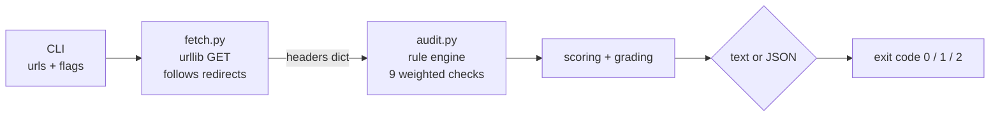

# hdrscope

**Zero-dependency HTTP security-header auditor.** Point it at any URL and get a
securityheaders.com-style grade (A+ … F) for the site's response headers, with a
line-by-line list of exactly what's missing and the exact header value to fix it.

```text
══════════════════════════════════════════════════════════════
 hdrscope — security header audit
 target : https://github.com
 status : HTTP 200
══════════════════════════════════════════════════════════════
 SCORE 77/100   GRADE [ B ]   5/9 checks pass
──────────────────────────────────────────────────────────────
 HEADER CHECKS
  ✓ HSTS                                 15/15 max-age=31536000; includeSubDomains
  ✓ Content-Security-Policy              20/20 no unsafe script sources detected
  ✓ X-Content-Type-Options              10/10 nosniff
  ✓ Clickjacking protection              10/10 DENY (CSP frame-ancestors also set)
  ⚠ Referrer-Policy                       ...
  ✗ Cross-Origin-Opener-Policy            0/5  absent
      → Add: Cross-Origin-Opener-Policy: same-origin
  ...
──────────────────────────────────────────────────────────────
```

## Why this exists

HTTP response headers are the cheapest, highest-leverage hardening control you
own: CSP kills XSS payload delivery, HSTS kills protocol downgrade SSL-stripping,
`X-Content-Type-Options: nosniff` kills MIME confusion attacks, and cookie
attributes kill session hijacking. Every web-audit checklist starts here
(OWASP Secure Headers Project, Mozilla Observatory) — and it's the first
thing an attacker's recon script checks too.

The usual workflow is a browser tab on a SaaS scanner, which doesn't fit
automation: you can't run `securityheaders.com` in CI, can't diff grades between
deploys, and can't audit 60 origins before a standup. **hdrscope is the missing
CLI**: one file of pure-stdlib Python, no plugins, no daemon, no API key.

```bash
pip install . && hdrscope https://example.com
```

Exit codes double as a CI gate, JSON output feeds your dashboards, and every
failing check prints the copy-pasteable header fix.

## Features

- **9 graded checks + 4 advisories** covering HSTS, CSP (incl. `unsafe-inline`,
  `unsafe-eval`, wildcard-source detection inside script contexts), MIME
  sniffing, clickjacking (X-Frame-Options *or* CSP `frame-ancestors`),
  Referrer-Policy, Permissions-Policy, COOP/CORP, and cookie flags
  (`Secure` / `HttpOnly` / `SameSite`) — plus unscored advisories for
  version disclosure, tech disclosure, legacy headers, and caching.
- **Weighted scoring & letter grades** close in spirit to the big scanners:
  CSP carries the most weight because XSS does the most damage.
- **Real-world parser quirks handled** — comma-separated Referrer-Policy lists,
  multiple `Set-Cookie` lines, `frame-ancestors` in CSP vs legacy XFO, redirect
  chains (audits the final response).
- **Text + JSON output**, exits 0/1/2 for clean CI gating on `--min-grade`.
- **Zero runtime dependencies.** Python ≥ 3.9 standard library only.

## Installation

From a clone of this repo:

```bash
git clone https://github.com/mehulpatel23b-pixel/hdrscope.git
cd hdrscope
pip install .          # installs the `hdrscope` entry point
```

or run it straight from source without installing anything:

```bash
PYTHONPATH=src python3 -m hdrscope https://example.com
```

Requirements: Python 3.9+ and nothing else. There is no `requirements.txt`
to satisfy because the standard library *is* the dependency list.

## Usage

```text
hdrscope URL [URL...] [--json] [--timeout N] [--min-grade GRADE]
```

| Flag | Meaning |
|---|---|
| `URL` | one or more targets; `https://` is assumed if you omit the scheme |
| `--json` | machine-readable report on stdout (text report goes to stderr-free stdout otherwise) |
| `--timeout N` | per-request timeout in seconds (default 15) |
| `--min-grade GRADE` | fail (exit 1) if any target grades below `GRADE`; one of `A+ A B C D F` |

### Exit codes (designed for CI)

| Code | Meaning |
|---|---|
| `0` | all reachable targets graded at or above `--min-grade` |
| `1` | at least one reachable target graded below `--min-grade` |
| `2` | at least one target could not be reached at all |

### Examples

```bash
# quick human-readable audit
hdrscope https://myapp.example.com

# gate a deploy: anything below a B fails the build
hdrscope https://staging.example.com --min-grade B

# whole estate before a standup
hdrscope https://a.example.com https://b.example.com https://c.example.com

# JSON for dashboards / diffing
hdrscope https://myapp.example.com --json > today.json
jq '.results[0].grade, .results[0].score' today.json
```

### CI gate (GitHub Actions)

```yaml
- name: Security header regression gate
  run: |
    pip install .
    hdrscope ${{ env.STAGING_URL }} --min-grade B
```

Fail the pipeline when a middleware refactor silently drops HSTS or your
CSP loses `default-src`. Pair with a daily cron job and you get alerted the
moment a deploy downgrades your header posture.

## What gets checked and how it's scored

| Check | Header(s) | Weight | Full points when |
|---|---|---:|---|
| HSTS | `Strict-Transport-Security` | 15 | `max-age ≥ 15552000` (180 days; recommend 31536000) |
| Content-Security-Policy | `Content-Security-Policy` | 20 | present, no `unsafe-inline`/`unsafe-eval`/wildcard in script contexts |
| MIME sniffing | `X-Content-Type-Options` | 10 | exactly `nosniff` |
| Clickjacking | `X-Frame-Options` / CSP `frame-ancestors` | 10 | `DENY`/`SAMEORIGIN` or `frame-ancestors` present |
| Referrer-Policy | `Referrer-Policy` | 10 | `no-referrer`, `same-origin`, `strict-origin`, or `strict-origin-when-cross-origin` |
| Permissions-Policy | `Permissions-Policy` | 5 | present |
| COOP | `Cross-Origin-Opener-Policy` | 5 | `same-origin` (or equivalent) |
| CORP | `Cross-Origin-Resource-Policy` | 5 | `same-origin`/`same-site`/`cross-origin` |
| Cookie flags | `Set-Cookie` | 10 | every cookie has `Secure`, `HttpOnly`, `SameSite` (not `None` without `Secure`); no cookies = n/a |

Score = points earned ÷ points possible. Grades: **A+ ≥ 97, A ≥ 90, B ≥ 75,
C ≥ 60, D ≥ 40, F below.** Advisories (Server version disclosure,
`X-Powered-By`, legacy `X-XSS-Protection`, missing `no-store`) never affect
the score but are worth fixing.

## How it works



```text
┌──────────────┐    GET (final hop)    ┌─────────────────────────────┐
│   cli.py     │ ────────────────────► │  fetch.py                    │
│  argparse,   │   response headers    │  normalize_url, urllib,     │
│  exit codes  │ ◄──────────────────── │  redirect follow, error map  │
└──────┬───────┘                       └──────────────┬──────────────┘
       │ report                                          │ {header: [values]}
       ▼                                                ▼
┌──────────────┐   Check(status, weight, earned)  ┌─────────────────────┐
│ text/json    │ ◄─────────────────────────────── │  audit.py           │
│ rendering    │   AuditResult(score, grade)      │  pure functions,    │
└──────────────┘                                  │  unit-testable      │
                                                  └─────────────────────┘
```

The rule engine is deliberately pure: it consumes a plain `{header: [values]}` map,
so every check, weight and grade boundary is tested without any network
(`python -m unittest` spins up throwaway local HTTP servers for the two
end-to-end paths). Fetching is isolated in `fetch.py` so the evaluation logic
never touches sockets.

## Security use cases

1. **Pre-launch hardening** — run against staging the week before launch and burn
   down the fix list before the world (and its bots) arrive.
2. **CI regression gate** — `--min-grade B` makes "the load balancer started
   stripping HSTS" a build failure instead of a pentest finding six months later.
3. **Estate audits** — loop your 50 hostnames through one command; JSON output
   gives you a sorted, diffable posture snapshot.
4. **Cookie flag verification** — confirm `Secure`/`HttpOnly`/`SameSite`
   actually made it into production after that session-cookie refactor.
5. **Header parity checks** — diff grades or `--json` output between dev,
   staging and prod to catch config drift in reverse proxies and CDNs.
6. **Pentest triage prep** — walk into an engagement with the obvious
   client-side findings already documented, so paid time goes deeper.
7. **Security awareness demos** — the A+ to F scale makes an instantly
   understandable demo for teaching developers why headers matter.

## Legal & ethical use

> ⚠️ **hdrscope is a defensive auditing tool. It performs a single plain GET
> request per target — nothing more invasive than visiting the page in a
> browser.** Use it only against systems **you own or are explicitly authorized
> to test** (your own sites, your employer's estate under the applicable rules
> of engagement, an engagement with written scope). Scanning third-party
> systems without permission is unlawful in most jurisdictions even with a
> harmless request. The tool never attempts exploitation, credential access,
> bypass, or scanning — one GET, header analysis, report. If you're looking for
> a weapon you're in the wrong repo; hdrscope is a seatbelt, not a crowbar.

## Development

```bash
git clone https://github.com/mehulpatel23b-pixel/hdrscope.git
cd hdrscope
PYTHONPATH=src python3 -m unittest discover -s tests   # 26 tests, no network
```

Test layout: `tests/test_hdrscope.py` covers the grading scale, every check's
good/warn/missing boundary conditions (including comma-policy and multi-cookie
quirks), URL normalization, and two end-to-end audits against disposable local
HTTP servers.

## License

MIT © Mehul Patel — see [LICENSE](LICENSE).
